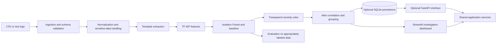

# Architecture

## Design principles

- Keep ingestion, transformation, detection, grouping, and presentation as separate modules.
- Route batch and API requests through shared application logic.
- Keep the initial installation local-first: SQLite is the default persistence target;
  PostgreSQL and a message broker are optional later extensions.
- Preserve log evidence and explain why an item was flagged; do not treat an anomaly as a
  confirmed incident or root cause.
- Keep raw/private data, secrets, and generated model artifacts out of Git.
- Add functionality incrementally and document which parts are implemented.

## Planned batch workflow



The diagram shows the target MVP boundaries, not completed functionality. Until later
phases implement these components, this repository contains setup and documentation only.

## Module responsibilities

| Module | Responsibility |
| --- | --- |
| `ingestion` | Read uploaded CSV/text inputs, validate size and schema, and produce events. |
| `preprocessing` | Normalize messages and timestamps; apply configured sensitive-data masking. |
| `templates` | Extract reusable message patterns while preserving event-to-template evidence. |
| `features` | Fit and reuse TF-IDF transformations consistently for training and inference. |
| `detection` | Provide Isolation Forest and a transparent frequency/statistical baseline. |
| `severity` | Map detector output and explicit rules to explainable severity labels. |
| `grouping` | Correlate related alerts without implying a confirmed incident or cause. |
| `evaluation` | Calculate reproducible metrics aligned with the dataset's labeling unit. |
| `persistence` | Store events, alerts, and groups locally in SQLite when enabled. |
| `api` | Expose validated HTTP interfaces by calling shared application services. |
| `config` | Load validated settings from environment variables and safe defaults. |
| `dashboard` | Present evidence, trends, alert groups, and exports without owning ML logic. |

## Repository layout

```text
src/log_anomaly/       Application package and domain modules
tests/unit/            Isolated component tests
tests/integration/     Cross-module and application-flow tests
docs/                  Architecture and project documentation
data/raw/              Local input data; do not commit private logs
data/processed/        Generated/normalized data; ignored by Git
models/                Generated model artifacts; joblib files are ignored
deployment/            Later Docker and deployment assets
loghub/                Existing dataset checkout; preserved and not part of the app package
```

## Implementation status

Only the project layout and environment configuration are established in Phase 1. Data
validation, preprocessing, model behavior, severity and grouping rules, persistence, API,
and UI are planned interfaces and must not be considered operational until implemented
and tested in their respective phases.
