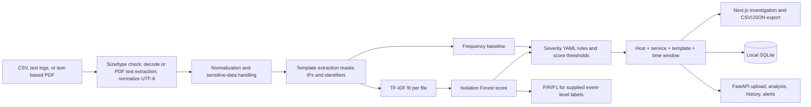

# Architecture

The application follows the user's four-stage architecture: ingestion; per-file ML;
explanation/grouping; delivery. A final operations/security layer is a production follow-up
and is not claimed complete.

## Design principles

- Keep ingestion, transformation, detection, grouping, and presentation as separate modules.
- Route batch and API requests through shared application logic.
- Keep the initial installation local-first: SQLite is the default persistence target;
  PostgreSQL and a message broker are optional later extensions.
- Preserve log evidence and explain why an item was flagged; do not treat an anomaly as a
  confirmed incident or root cause.
- Keep raw/private data, secrets, and generated model artifacts out of Git.
- Add functionality incrementally and document which parts are implemented.

## Implemented local MVP workflow



Format parsers support CSV, Apache access logs, Java-style logs with stack-trace merging, and
generic text. UTF-8, BOM-marked UTF-16/32, and common legacy encodings are normalized to
Unicode/UTF-8 in memory; CSV data can be recognized by content independently of the filename
extension. Binary uploads are rejected. The detector and vectorizer are fitted independently
for each uploaded file. Automatic selection uses a frequency baseline for fewer than 20
events or fewer than five distinct message templates; otherwise it uses TF-IDF with
Isolation Forest. The expected anomaly rate is a configurable scoring target, not a guarantee
of an exact flagged percentage. Evaluation is shown only when valid per-event labels are
supplied; results are not generalizable benchmark results.

## Module responsibilities

| Module | Responsibility |
| --- | --- |
| `ingestion` | Read uploaded CSV/text inputs, validate size and schema, and produce events. |
| `preprocessing` | Normalize messages and timestamps; apply configured sensitive-data masking. |
| `templates` | Extract reusable message patterns while preserving event-to-template evidence. |
| `features` | Fit and reuse TF-IDF transformations consistently for training and inference. |
| `detection` | Provide Isolation Forest and a transparent frequency/statistical baseline. |
| `severity` | Map detector output and explicit rules to explainable severity labels. |
| `grouping` | Correlate related alerts without implying a confirmed incident or cause. |
| `evaluation` | Calculate reproducible metrics aligned with the dataset's labeling unit. |
| `persistence` | Store events, alerts, and groups locally in SQLite when enabled. |
| `api` | Expose a validated local-development HTTP interface over shared application services. |
| `config` | Holds backend rules and configuration. |
| `frontend` | Presents scores, evidence, alert groups, labels/metrics, and exports. |

## Repository layout

```text
backend/
  src/log_anomaly/     FastAPI API and reusable analysis modules
  tests/unit/          Isolated Python component tests
  tests/integration/   Cross-module and API-flow tests
  config/              Severity rules and backend configuration
  data/                Local input data and generated SQLite database
  models/              Generated model artifacts
  pyproject.toml        Python package, test, and lint configuration
  requirements*.txt    Python dependencies
frontend/
  src/app/             Next.js pages, layout, and global styles
  src/components/      Dashboard and reusable UI components
docs/                  Architecture and project documentation
deployment/            Later Docker and deployment assets
loghub/                Existing dataset checkout; separate from application code
```

## Implementation status

Implemented: local batch ingestion and validation, common parser selection, text-based PDF
extraction with OCR scans rejected, preprocessing,
per-file TF-IDF/Isolation Forest and frequency scores, severity assignment, alert grouping,
Next.js dashboard, FastAPI upload/analysis/history/alerts endpoints, CSV/JSON exports,
optional anomaly-filtered PDF/Excel reports, per-event evaluation metrics, and SQLite storage.

Not implemented: robust parsing for every vendor format, template mining with Drain3,
multi-user persistence/PostgreSQL, authentication/authorization, rate limiting, operational
monitoring, backups, Docker/CI, and production deployment. The API has no authentication and
must remain local/trusted until hardened.
