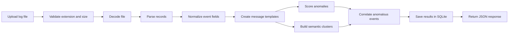
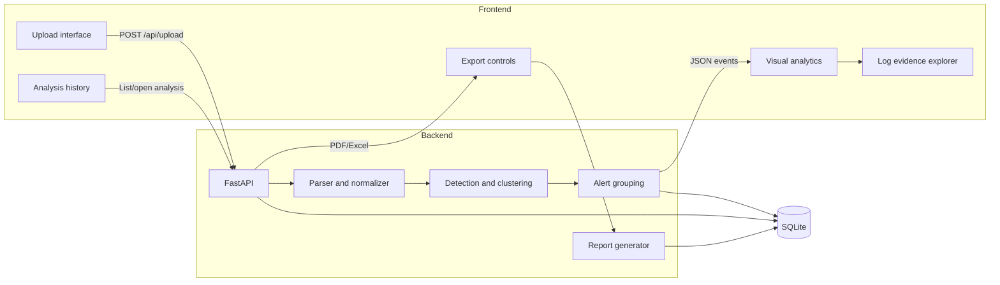

# Anomaly Detect
## Academic Minor Project Report

**Student:** [Name]  
**Roll number:** [Roll number]  
**Department / Institution:** [Department and institution]  
**Project guide:** [Guide name]  
**Academic year:** [Academic year]  
**Report date:** 25 November 2026

---

## Abstract

Anomaly Detect is a local-first application for analyzing application, server, and
system logs. A user uploads a log file through a web dashboard. The Python backend
validates and parses the file, normalizes events, generates message templates,
scores unusual records, assigns semantic clusters, and groups related anomalies.
The dashboard then presents summary metrics, charts, log evidence, analysis
history, and export options.

The project is considered in two stages: the **Minimum Core Product (MCP)** is the
essential backend pipeline that turns a valid log file into saved, explainable
analysis results; the **Minimum Viable Product (MVP)** adds the usable web
application around that pipeline. The current repository contains both stages in
one backend/frontend project rather than as separate products.

The detector uses a frequency baseline for small or low-variety files and
TF-IDF with Isolation Forest for larger, more varied files. DBSCAN produces
semantic text clusters. A separate correlation step groups anomalous events using
host, service, template, and a configurable time window. The application is a
prototype for analyst investigation. Its scores are not proof of an attack, root
cause, or operational incident.

**Keywords:** log analysis, anomaly detection, TF-IDF, Isolation Forest, DBSCAN,
alert correlation, FastAPI, Next.js, SQLite, data visualization.

## Project Overview: What the Website Does

**Anomaly Detect** is a web application that helps a user review log files and
find records that look unusual compared with other records in the same file.
Instead of manually reading every line, the user uploads a supported log file,
reviews scored events and related patterns in a dashboard, and downloads or
reopens the results. It is an investigation aid: a flagged event is a lead to
inspect, not proof of an attack, service failure, or root cause.

### Problem addressed

Application and system logs can contain many repetitive records, making unusual
events difficult to spot by hand. This project automates an initial triage step:
it turns supported log formats into structured events, compares their message
patterns, highlights relatively unusual events, and provides the original
evidence for a person to investigate.

### Main user workflow

1. Open the Next.js website and choose **Upload & Ingest**.
2. Select a `.csv`, `.txt`, `.log`, or text-based `.pdf` file and a time window
   for correlating alerts.
3. The FastAPI backend validates the upload, parses records, normalizes their
   fields, and creates a reusable template for each message.
4. The backend scores events using its automatic per-file detector choice,
   creates text-similarity clusters, and assigns group IDs to qualifying
   anomalies.
5. The website displays the analysis as summary metrics and charts, then lets
   the user filter and inspect individual event evidence.
6. Results are saved in local SQLite. The user can reopen them from **Analysis
   History** and export analysis reports or event data.

### What the user can see and do

| Website area | Purpose |
|---|---|
| Upload & Ingest | Choose a supported file, see the upload limit/progress, and set the alert-grouping window. |
| Visual Analytics | Review event and anomaly counts, score distribution, semantic clusters, timestamp-based charts, and severity values present in the input. |
| Investigation Evidence | Filter to anomalous, normal, or all events; inspect original messages, timestamps, scores, detector explanations, clusters, and alert group IDs. |
| Analysis History | Search recent saved analyses, reopen one, and download PDF/Excel reports. |
| Event exports | Download the current analysis as CSV or JSON; PDF/Excel exports can optionally exclude anomalous events. |

### Scope and important boundaries

- The application analyzes uploaded batches; it does not continuously monitor
  live log streams.
- Detection is fitted to each uploaded file. Scores are relative to that file
  and are not calibrated probabilities or directly comparable between uploads.
- Semantic clusters group similar message text. Alert groups correlate only
  events already flagged as anomalous. These are separate operations.
- The dashboard displays severity values parsed from the input. Although a
  configurable severity-assessment utility exists in the backend, it is not
  currently connected to the main upload-and-analysis workflow.
- The current deployment is intended for local/trusted use. API-key protection
  is a shared bearer key, not individual user accounts or role-based access.

## 1. MCP vs MVP for Anomaly Detect

### 1.1 MCP: Minimum Core Product

The MCP is the smallest technically complete backend that can accept a log file,
parse it into events, detect unusual records, assign explanations and group IDs,
persist results, and return a structured response. It concentrates on correctness
of the data and analysis pipeline, not on visual presentation.

### 1.2 MVP: Minimum Viable Product

The MVP is the demonstrable application built around the MCP. It allows a user to
upload logs, choose a grouping window, view charts and detected anomalies,
investigate event evidence, reopen prior analyses, and export reports.

### 1.3 How they relate in this repository

The backend and frontend are in the same repository:

- The backend contains the MCP functions and the APIs needed by the application.
- The frontend calls the APIs and makes the MCP usable through a dashboard.
- The database and exports support the complete user workflow.

MCP and MVP are therefore project-development stages and scope definitions. They
are not two separately deployed services in the current implementation.

## 2. MCP - Minimum Core Product

### 2.1 Core architecture

The MCP contains the essential processing components below. The priorities
describe their importance to the core pipeline, not a claim that each component
has been independently benchmarked.

| Module | Minimum requirement | Priority | Current implementation |
|---|---|---:|---|
| File ingestion | Accept and validate CSV, TXT, and LOG files | Critical | Implemented; text-based PDF is also supported |
| Parser | Extract message and available timestamp/severity/source fields | Critical | Implemented for selected formats and CSV aliases |
| Normalization | Clean messages, normalize timestamps, create templates | Critical | Implemented |
| Baseline detection | Score rare templates and flag unusual records | Critical | Implemented |
| ML detection | TF-IDF features with Isolation Forest | High | Implemented and selected automatically for qualifying files |
| Semantic clustering | Assign similar message patterns with DBSCAN | Medium | Implemented |
| Alert correlation | Group anomalies by host, service, template, and time | High | Implemented |
| Severity display | Preserve and show severity values from log records | Supporting | Parsed input values are shown; the separate YAML-based score assessment utility is not wired into the main analysis pipeline |
| Persistence | Save analysis metadata and event data in SQLite | High | Implemented |
| API | Upload, analyze, retrieve, and export analysis data | Critical | Implemented with FastAPI |
| Testing | Test parser, pipeline, grouping, API, and persistence behavior | Critical | Unit and integration test files are present |

### 2.2 MCP processing pipeline



### 2.3 MCP modules and responsibilities

1. **Ingestion:** Accepts the file and rejects unsupported types, empty content,
   invalid encodings, oversized uploads, and unsupported PDF input.
2. **Parsing:** Converts CSV or supported text patterns into event rows with
   fields such as message, timestamp, severity, host, service, source, and label
   when those values can be identified.
3. **Normalization:** Cleans message whitespace, creates missing event IDs,
   converts parseable timestamps to UTC, and supplies absent optional columns.
4. **Template extraction:** Creates a pattern from a message by replacing
   supported variable values such as IP addresses, UUIDs, long hexadecimal
   strings, and long numbers. The original message remains in the event.
5. **Detection:** Assigns an anomaly score, boolean anomaly flag, detector method,
   and short explanation.
6. **Semantic clustering:** Uses TF-IDF and DBSCAN to group similar templates for
   browsing and cluster summaries.
7. **Alert correlation:** Assigns `INC-0001`-style IDs to anomalous records that
   meet the grouping-key and time rules.
8. **Persistence:** Stores analysis metadata and serialized event records in
   SQLite so the analysis can be listed and reopened.
9. **API response:** Returns analysis details and event records as JSON for the
   frontend or another API client.

### 2.4 MCP completion criteria

| Completion criterion | Evidence in the project |
|---|---|
| A valid log file can be uploaded | `POST /api/upload` validates and parses file uploads |
| Invalid files are rejected safely | Parser and API tests cover empty, malformed, binary, unsupported, or invalid PDF cases |
| Events use a consistent structure | Parser output is normalized into event fields |
| Original messages are preserved | The message and normalized template are distinct fields |
| Scores and anomaly flags are generated | The analysis module adds `anomaly_score` and `is_anomaly` |
| Related anomalies receive group IDs | The correlation module adds `group_id` to eligible anomaly rows |
| Results can be saved and retrieved | SQLite store and analysis history/detail routes are present |
| Core behavior has automated tests | Backend unit and API integration test files cover the main pipeline |

The evidence above describes repository implementation and test coverage. Test
presence does not replace running the tests or validating the system with a
documented external dataset before submission.

### 2.5 MCP algorithm details

#### Automatic detector selection

The dashboard currently submits `method=auto`. The backend chooses:

| Input condition | Selected scoring method |
|---|---|
| At least 20 events and at least 5 unique message templates | TF-IDF + Isolation Forest |
| Fewer than 20 events or fewer than 5 unique message templates | Frequency baseline |

The API also accepts explicit `baseline`, `isolation_forest`, or `clustering`
methods. The current dashboard keeps its method set to `auto`.

#### Frequency baseline

For a template \(t\), let \(c(t)\) be the number of times it appears in the
uploaded file. The raw rarity score is:

\[
r(t) = \frac{1}{c(t)}
\]

The raw scores are scaled to 0-1 using min-max scaling:

\[
s_i = \frac{x_i - \min(x)}{\max(x) - \min(x)}
\]

If all scores are equal, the implementation returns zeros. An event is flagged
when its score is at or above the quantile selected by the contamination target.
Equal scores around the threshold can result in a flagged count that differs from
the requested rate.

#### TF-IDF and Isolation Forest

The backend converts message templates to TF-IDF feature vectors. Isolation
Forest estimates which vectors are isolated relative to the other events in that
same uploaded file. The backend negates the decision-function result so that
larger values mean more unusual, then scales scores to 0-1.

The model is fitted per uploaded file. It is not a pretrained model shared between
files, and the scores are not calibrated probabilities that should be compared
across separate uploads.

#### DBSCAN semantic clustering

The backend also vectorizes templates and runs DBSCAN using cosine distance,
`eps=0.45`, and `min_samples=2`. It orders non-noise clusters by size and gives
them readable labels based on common service/template text. Noise records receive
an outlier label. This semantic clustering runs separately from alert grouping
and is not controlled by the grouping-window setting.

## 3. MVP - Minimum Viable Product

### 3.1 Essential MVP features

| Feature | MVP behavior in the current application |
|---|---|
| Dashboard | Shows total events, anomalies, anomaly ratio, semantic clusters, and alert groups |
| Log upload | Accepts CSV, TXT, LOG, and PDF; checks extension and file-size limit; shows upload progress and errors |
| Analytics | Displays event status, score distribution, cluster distribution, timeline, and severity charts |
| Log evidence explorer | Shows message, timestamp, severity, score, cluster, group ID, and explanation |
| Anomaly filters | Filters the evidence table to anomalies, normal events, or all events |
| Cluster inspection | Opens the event table filtered to the selected semantic cluster |
| Alert grouping | Allows the user to select a time window and see group IDs on anomalous events |
| History | Lists saved analyses, supports search/format filters, and reopens results |
| Export | Generates PDF/Excel from the backend and CSV/JSON in the browser; can exclude anomalies |
| Evaluation display | Shows precision, recall, and F1 only when all events contain recognized labels |

### 3.2 MVP architecture



### 3.3 MVP technology stack

| Layer | Technology | Purpose |
|---|---|---|
| Frontend | Next.js, React, TypeScript | User interface and frontend state |
| Visualization | Recharts | Responsive charts, axes, legends, and tooltips |
| Backend | Python and FastAPI | HTTP API and request validation |
| Data processing | pandas and NumPy | Event transformation and scoring arrays |
| Machine learning | scikit-learn | TF-IDF, Isolation Forest, DBSCAN, and metric utilities |
| Database | SQLite | Local analysis metadata and event JSON |
| PDF processing | pypdf | Extract text from text-based PDF uploads |
| PDF reports | ReportLab | Build report PDFs |
| Excel reports | openpyxl | Build `.xlsx` workbooks |
| Testing | pytest and FastAPI TestClient | Unit and API workflow tests |

The project should keep this stack stable for the minor-project demonstration.
New infrastructure or frameworks should be added only when a specific requirement
justifies them.

### 3.4 Dashboard graphs and parameters

The dashboard derives graph data in the browser from the API response's event
array. The charts do not use the event table's active filters. A user can filter
the evidence table without changing the displayed aggregate charts.

#### Event status pie chart

- **Parameter:** `is_anomaly`.
- **Values:** Total normal events and total anomalous events.
- **Meaning:** Shows the composition of the current analysis.
- **Colors:** Green for normal and red for anomalous.

#### Anomaly score distribution

- **Parameter:** `anomaly_score`.
- **Ranges:** 0.0-0.2, 0.2-0.4, 0.4-0.6, 0.6-0.8, and 0.8-1.0.
- **Axes:** Score range on the horizontal axis; event count on the vertical axis.
- **Meaning:** Shows how scores are distributed for this file. A score is not a
  probability of an incident.

#### Cluster distribution

- **Parameter:** `cluster_id` (semantic cluster ID), not `group_id` (alert group).
- **Values:** Number of events in each semantic cluster.
- **Display:** Sorted by cluster size; at most eight entries are shown in the bar
  chart, with long labels shortened.
- **Meaning:** Shows recurring text patterns and their event counts. Changing the
  alert-grouping window does not change these clusters.

#### Anomaly timeline

- **Parameters:** `timestamp` and `is_anomaly`.
- **Values:** Normal and anomalous event counts in automatically calculated
  timestamp buckets.
- **Bucket count:** Between 5 and 20, based approximately on one bucket per four
  timestamp-bearing events.
- **Visibility:** The chart is omitted when the result does not provide a usable
  timestamp series.
- **Important:** These chart buckets are a visualization interval, not the alert
  grouping window.

#### Severity breakdown

- **Parameters:** `severity` and `is_anomaly`.
- **Values:** Normal and anomalous counts for each severity.
- **Order:** CRITICAL, ERROR, WARN, WARNING, INFO, DEBUG, followed by any other
  levels. Missing severity is displayed as INFO.
- **Meaning:** Shows the severity values present in the records. Severity does not
  by itself determine whether an event is anomalous.

#### Summary cards and evaluation metrics

- **Total Log Events:** Count of all events returned for the analysis.
- **Detected Anomalies:** Count where `is_anomaly` is true.
- **Anomaly Ratio:** Anomalies divided by total events, as a percentage.
- **Identified Clusters:** Number of semantic cluster labels represented.
- **Alert Groups:** Number of distinct non-null `group_id` values among anomalies.
- **Precision, Recall, F1:** Shown only if every event has a recognized label.

The frontend accepts positive labels such as `1`, `true`, `anomaly`, `abnormal`,
and `yes`; it accepts negative labels such as `0`, `false`, `normal`, and `no`.
These metrics measure agreement against the supplied labels for the uploaded
records. They do not prove generalization to unseen data.

### 3.5 Alert grouping workflow and grouping-window behavior

The grouping window is selected on the upload page and submitted to the backend as
`grouping_window_minutes`. The UI default is 5 minutes, with choices 1, 5, 10, 15,
30, and 60. The API accepts integer values from 1 to 1,440.

The backend groups only records already marked anomalous. For each anomaly it
builds this exact key:

```text
(host, service, template)
```

The algorithm processes events in timestamp order. For the same key, it reuses the
most recent group if both timestamps exist and their difference is at most the
selected window. When both timestamps are missing, the events can still reuse the
same group because no time comparison is possible. If one timestamp is missing,
the key differs, or the time gap is larger than the window, a new group is created.
Normal events keep a null group ID.

Group IDs are sequential within one analysis, for example `INC-0001` and
`INC-0002`. Each event is compared with the most recently processed event for its
key, so a chain of adjacent events within the threshold can remain in one group
even when the first and last events span more than one window. IDs are not globally
unique incident records.

#### Effect of changing the grouping window

| Change | Expected effect |
|---|---|
| Smaller window | Fewer time-separated matching anomalies join; group count can increase |
| Larger window | More matching anomalies may join; group count can decrease |
| Different host, service, or template | Events stay in separate groups |
| Both timestamps missing | Matching keys may group without a time-gap check |
| Event is normal | It is not assigned a group and does not connect anomalies |

The upload form's helper text mentions matching host/service; the implementation
also requires the template to match. The grouping window affects alert grouping,
not the anomaly score, DBSCAN clusters, or timeline chart. The returned event
group IDs are persisted, but the chosen window is not stored as a dedicated
analysis metadata field in SQLite.

### 3.6 Log evidence, history, and export

The evidence table presents event status, timestamp, severity, semantic cluster,
original message, anomaly score, alert group, and detector explanation. Users can
filter to anomaly, normal, or all events, and can further filter by semantic
cluster.

The backend saves analysis metadata and an event JSON payload in SQLite. The
history page can search by filename or format, reopen a prior analysis, and invoke
PDF/Excel exports. CSV and JSON files are assembled from the current browser
analysis result. The export control can exclude anomalous events.

## 4. MCP vs MVP: Feature Comparison

| Feature | MCP | MVP |
|---|---|---|
| File validation and parsing | Required | Included |
| Event normalization and templates | Required | Included |
| Frequency-baseline detection | Required | Included |
| TF-IDF + Isolation Forest | Optional extension | Included and auto-selected for qualifying files |
| Alert correlation | Required | Included with configurable time window |
| Semantic clustering | Optional | Included |
| API analysis response | Required | Used by the frontend |
| SQLite persistence | Required for saved/retrieved analyses | Used by history and exports |
| Interactive dashboard | Not required | Included |
| Log evidence filters | Basic API records | Interactive filters |
| Analysis history | Basic persistence | Search and reopen |
| PDF/Excel exports | Not required | Included |
| CSV/JSON downloads | Not required | Included |
| Charts and analytics | Not required | Included |
| Evaluation metrics | Unit-level evaluation | Conditional on supplied labels |

## 5. Recommended Development Roadmap

The project already has a FastAPI backend, a Next.js frontend, and SQLite. It
should be improved in place rather than rebuilt from scratch. The phases below
provide a presentation and verification order; they are not a claim that every
acceptance test has already been run.

### Phase 1 - Core backend (MCP)

- Verify file ingestion and error handling.
- Verify field extraction and normalization for each supported format.
- Verify baseline and Isolation Forest selection/scoring.
- Verify semantic clustering separately from alert correlation.
- Verify group-key and time-window behavior, including missing timestamps.
- Confirm stable response structure and event evidence.

**Deliverable:** A reliable, explainable backend analysis pipeline.

### Phase 2 - Database and API

- Verify SQLite persistence and history retrieval.
- Verify upload and JSON analysis endpoints.
- Verify API-key configuration and request validation.
- Verify that saved records can be reopened and exported.
- Document retention and the sensitivity of stored log messages.

**Deliverable:** A complete local backend workflow.

### Phase 3 - Frontend

- Verify upload validation, progress, and error messages.
- Confirm the dashboard uses live API responses.
- Verify analytics against known sample counts.
- Verify evidence filtering and semantic-cluster inspection.
- Confirm the grouping-window selector changes returned alert groups.

**Deliverable:** A usable end-to-end web interface.

### Phase 4 - Reporting

- Verify PDF and Excel output against the stored analysis.
- Verify CSV and JSON downloads against current event records.
- Verify the exclude-anomalies option.
- Check that report metadata and record counts agree with the source analysis.

**Deliverable:** Reproducible analysis exports.

### Phase 5 - Testing and academic evaluation

- Run backend unit and integration tests.
- Run frontend lint and production build checks.
- Use a documented labeled dataset for model evaluation.
- Prefer separate training/test data or a time/source-separated holdout.
- Calculate precision, recall, and F1 and report dataset limitations.
- Do not use synthetic data or same-file exploratory scores as proof of
  generalization.

**Deliverable:** A demonstrable and academically defensible MVP.

## 6. Post-MVP Enhancements (Future Scope)

These features are not required for the first minor-project demonstration. They
should be considered only after the current pipeline is tested and its intended
workload is clear.

| Enhancement | Purpose | Priority |
|---|---|---:|
| Drain3 or another template miner | Improve template extraction for varied log formats | High |
| One-Class SVM | Evaluate an additional detector against a baseline | Medium |
| LSTM or autoencoder | Explore sequence-based anomaly detection | Medium |
| Ensemble detection | Combine detectors after individual evaluation | Medium |
| Drift detection | Identify changes in event patterns over time | Later |
| Live monitoring | Analyze a continuing log stream | Later |
| Kafka integration | Support distributed streaming ingestion if required | Later |
| Email/Slack alerts | Notify users of selected high-priority events | Later |
| Root-cause assistance | Support investigation without claiming proof | Later |
| PostgreSQL | Support future relational/concurrent workloads if justified | Later |
| Docker and CI/CD | Improve deployment repeatability and automation | Later |
| User accounts and role-based authorization | Add individual users and per-user access control beyond the existing shared API key | Later |

Advanced models should be selected based on measured results, not added only to
increase the number of technologies in the project.

## 7. Testing Criteria: How to Know the MVP Is Ready

| Test case | Expected result | Existing test coverage |
|---|---|---|
| Upload valid CSV | Parsed events and analysis response are returned | Parser and API tests are present |
| Upload malformed CSV | Clear validation error is returned | Parser validation test is present |
| Upload empty file | File is rejected | Parser test is present |
| Upload Java logs | Supported fields parsed and stack traces merged | Parser test is present |
| Upload Apache logs | Supported host, timestamp, and status severity extracted | Parser test is present |
| Upload normal and unusual messages | Scores, flags, and explanations are returned | Detector tests are present |
| Change grouping window | Group IDs are recalculated according to selected interval | Group-key/time-window unit coverage is present; UI end-to-end check remains useful |
| Filter by semantic cluster | Evidence table shows matching events | Manual frontend interaction check recommended |
| Open previous analysis | Persisted analysis and events appear | SQLite/API history tests are present |
| Export PDF | A valid report is generated | API export test is present |
| Export Excel | A valid workbook is generated | API export test is present |
| Upload a labeled dataset | Evaluation metrics are computed for valid labels | Metric-function test is present; labeled-dataset evaluation is still required |

The test files are in [backend/tests/unit](backend/tests/unit) and
[backend/tests/integration](backend/tests/integration). Frontend lint and build
commands are documented in the root [README.md](README.md). The table records
coverage visible in the repository; run the commands below before submitting and
record actual results in the final academic report.

```powershell
Push-Location backend
..\.venv\Scripts\python.exe -m pytest
..\.venv\Scripts\python.exe -m ruff check .
Pop-Location
npm --prefix frontend run lint
npm --prefix frontend run build
```

## 8. Important Recommendations for the Existing Project

1. **Audit before adding features.** Several MVP capabilities already exist in
   the code. Verify them and their limits before implementing another version.
2. **Keep the MCP reliable.** Parsing, normalization, error handling, scoring,
   and alert correlation are the foundation for every chart and export.
3. **Keep the two types of grouping distinct.** Semantic clusters group text
   patterns; alert groups correlate anomalous records by key and time.
4. **Use real labels carefully.** Cite the dataset, license, collection method,
   label definition, and split strategy. Same-file evaluation is exploratory.
5. **Treat original logs as sensitive.** Template masking does not erase the
   original message stored in SQLite or returned to the user.
6. **Do not expose the prototype publicly without further controls.** Current
   bearer API-key validation is a shared-key mechanism, not user accounts or
   tenant isolation. The system also needs appropriate resource, retention, and
   deployment controls before untrusted use.
7. **Review exported values.** Spreadsheet formula-leading values from untrusted
   logs need safe handling before exports are relied on in sensitive workflows.
8. **Keep the technology stack focused.** Add streaming, databases, or advanced
   models only when there is a measured requirement.

### 8.1 Repository organization

```text
log_anomaly/
├── backend/
│   ├── src/log_anomaly/
│   │   ├── api/
│   │   ├── ingestion/
│   │   ├── preprocessing/
│   │   ├── detection/
│   │   ├── grouping/
│   │   ├── persistence/
│   │   ├── reports/
│   │   └── service.py
│   └── tests/
├── frontend/
│   └── src/
│       ├── app/
│       └── components/
├── docs/
│   └── architecture.md
├── loghub/
├── README.md
└── project.md
```

The actual repository also contains configuration, deployment files, notebooks,
and data directories. `loghub/` is a separate dataset checkout and should be
treated according to its own provenance and licensing information.

## 9. Running the Project for a Demonstration

The repository README provides Windows PowerShell setup instructions. A concise
local sequence is:

1. Create a Python virtual environment and install backend development
   requirements.
2. Install frontend dependencies with `npm --prefix frontend ci`.
3. Create local backend and frontend environment files from their example files.
4. Configure the same API key for the backend and frontend when protected API
   routes are used. Do not put a real secret into a committed file.
5. Start FastAPI from the `backend` directory.
6. Start Next.js from the repository root with `npm --prefix frontend run dev`.
7. Open `http://localhost:3000`, upload a supported sample file, select a grouping
   window, and inspect analytics and event evidence.

For the exact commands and configuration names, use [README.md](README.md),
[backend/README.md](backend/README.md), and
[frontend/README.md](frontend/README.md).

## 10. Final Project Definition

**Project:** Anomaly Detect

**MCP:** A Python-based log processing engine that validates, parses, normalizes,
scores, clusters, correlates, and persists unusual log events.

**MVP:** A full-stack web application that lets a user upload log files, visualize
the analysis, investigate event evidence and correlated alert groups, access
analysis history, and export reports.

**Advanced product:** A future log-intelligence platform with real-time ingestion,
evaluated adaptive detection, richer correlation, notifications, investigation
support, and scalable deployment controls.

### Recommended order of work

1. **MCP:** Make the analysis engine reliable.
2. **MVP:** Make the complete workflow usable and demonstrable.
3. **Evaluation:** Measure detection against documented labeled data.
4. **Advanced features:** Add only those supported by project requirements and
   evaluation.

## Conclusion

Anomaly Detect already combines the central MCP pipeline with an MVP user
experience. The backend parses and scores a batch, creates semantic clusters,
correlates anomalies, stores the result, and exposes it through an API. The
frontend turns that response into charts, an evidence explorer, history, and
exports.

For the academic demonstration, the most important explanation is how each part
differs: the anomaly detector decides which events are unusual; semantic
clustering groups similar message patterns; alert correlation assigns group IDs
using matching host, service, template, and timestamps; and dashboard graphs
summarize the returned records. The grouping window changes alert correlation,
not the detector or semantic clusters.

The project should be presented as a local prototype and investigation aid.
Documented dataset evaluation, careful privacy handling, export safety, and
operational controls remain necessary before making production-quality claims.
